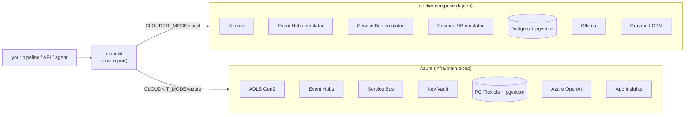

# Azure Local Lab

**Build against Azure on a laptop. Ship to Azure by changing one env var.**


Every data and AI project I build depends on this lab. It gives three guarantees:

1. **The same SDK on both sides.** Code uses the official `azure-storage-blob`, `azure-eventhub`, `azure-servicebus`, `azure-keyvault-secrets` and `openai` clients. Locally they reach Microsoft's own emulators. In the cloud they reach real resources over Entra ID (no keys).
2. **Switching is configuration, not code.** `CLOUDKIT_MODE=local` targets `docker compose`. `CLOUDKIT_MODE=azure`, plus the outputs of `infra/main.bicep`, targets Azure.
3. **Traces from day one.** OpenTelemetry sends to Grafana (Tempo, Prometheus, Loki) locally and to Application Insights in Azure, with the same instrumentation.



## Service map

| Azure service | Local stand-in | Port(s) | cloudkit entry point | Fidelity |
|---|---|---|---|---|
| Blob Storage / ADLS Gen2 | Azurite (official) | 10000–10002 | `blob_service()` | same SDK |
| Event Hubs (AMQP + Kafka) | Event Hubs emulator (official) | 5672, 9092 | `eventhub_producer()`, `eventhub_consumer()`, `kafka_config()` | same SDK |
| Service Bus | Service Bus emulator (official) + SQL Server | 5673, 14330 (`LAB_MSSQL_PORT`) | `servicebus_client()` | same SDK |
| Cosmos DB (NoSQL) | Cosmos DB Linux emulator (official) | 8081 | use `azure-cosmos` directly | same SDK |
| PostgreSQL Flexible + pgvector | `pgvector/pgvector` | 5433 (`LAB_PG_PORT`) | `postgres_connect()` | same driver |
| Azure OpenAI | Ollama (OpenAI-compatible API) | 11434 | `llm_client()` | same `openai` SDK |
| Key Vault | environment variables / `.env` | – | `get_secret()` | same call site |
| App Insights / Azure Monitor | Grafana `otel-lgtm` | 3001 (`LAB_GRAFANA_PORT`), 4317 | `telemetry.configure()` | same OTel API |

Azure AI Search, Databricks, Fabric and Data Factory have no emulator. Projects put them behind an interface, using pgvector for search and local Spark with Delta for the lakehouse, and say so in their own README.

## Quickstart

```bash
./scripts/init-env.sh            # or: pwsh scripts/init-env.ps1   -> random local-only passwords in .env
docker compose up -d             # core: Azurite, Postgres+pgvector, Grafana LGTM
docker compose --profile streaming up -d   # + Event Hubs emulator
uv sync
uv run pytest                    # unit tests, no containers needed
uv run pytest -m integration     # against the running lab
uv run python scripts/smoke.py   # one traced run through every running service
```

Open Grafana at http://localhost:3001 (admin/admin). Go to **Explore → Tempo** and pick service `lab-smoke` to see the run as a trace.

Profiles: `streaming` · `messaging` · `cosmos` · `ai` · `all`.

## Using it in a project

```python
from cloudkit import blob_service, eventhub_producer, get_secret, llm_client
from cloudkit import telemetry

telemetry.configure("fraud-scorer")
lake = blob_service().get_container_client("bronze")
llm = llm_client()  # Ollama locally, Azure OpenAI (Entra ID) in the cloud
db_password = get_secret("db-password")  # env DB_PASSWORD locally, Key Vault secret in Azure
```

## Going to real Azure (and back out the same day)

```bash
az login
az group create -n rg-lab -l westeurope
az deployment group what-if -g rg-lab -f infra/main.bicep -p principalId=$(az ad signed-in-user show --query id -o tsv)
az deployment group create  -g rg-lab -f infra/main.bicep -p principalId=$(az ad signed-in-user show --query id -o tsv) --query properties.outputs
# export the outputs (CLOUDKIT_MODE=azure, AZURE_STORAGE_ACCOUNT=...), then:
uv sync --extra azure && uv run python scripts/smoke.py
az group delete -n rg-lab --yes --no-wait
```

Design choices in `infra/main.bicep`:
- **No keys anywhere.** `allowSharedKeyAccess: false` and `disableLocalAuth: true`. Access is RBAC data-plane roles only, assigned to `principalId`.
- **ADLS Gen2** (`isHnsEnabled`) with `bronze` / `silver` / `gold` containers.
- **Event Hubs Standard**, the lowest tier with a Kafka endpoint, so Kafka clients work unchanged.
- **Postgres is opt-in** (`deployPostgres=true`) because it is the only resource with a noticeable hourly cost.
- Every resource is tagged `ttl: delete-same-day`. **Create a budget alert in the portal before the first deploy.**

## Tests and CI

- `tests/test_config.py`: mode switching, endpoint building and fail-fast checks for missing Azure settings. Needs no network.
- `tests/test_integration.py`: blob round trip, pgvector similarity ordering, and Event Hubs send/receive against the running emulators.
- `.github/workflows/ci.yml` has three jobs:
  - `lint-test`: ruff, mypy, unit tests.
  - `integration`: brings the emulators up inside GitHub Actions, then runs the integration tests and the smoke script.
  - `infra`: Bicep build and lint.

## Skills this demonstrates

Cloud-portable architecture · Azure identity (Entra ID, RBAC, keyless) · Bicep IaC · Event-driven ingestion (Event Hubs, Kafka protocol) · Lakehouse storage (ADLS Gen2) · Vector search (pgvector) · LLM provider abstraction · OpenTelemetry observability · Integration testing against emulators in CI.
